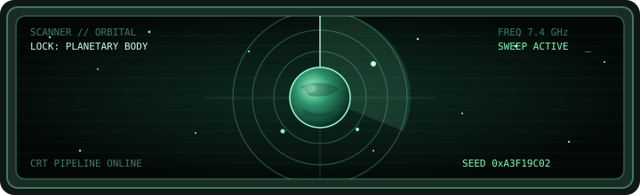

<div align="center">

<pre>
    ____  ________________     _____ ____  ___   ____________
   / __ \/ ____/ ____/ __ \   / ___// __ \/   | / ____/ ____/
  / / / / __/ / __/ / /_/ /   \__ \/ /_/ / /| |/ /   / __/
 / /_/ / /___/ /___/ ____/   ___/ / ____/ ___ / /___/ /___
/_____/_____/_____/_/       /____/_/   /_/  |_\____/_____/

    ___  ________    ___   _____
   /   |/_  __/ /   /   | / ___/
  / /| | / / / /   / /| | \__ \
 / ___ |/ / / /___/ ___ |___/ /
/_/  |_/_/ /_____/_/  |_/____/
</pre>

[](https://github.com/paugm/deep-space-atlas)


[Play online](https://deepspaceatlas.net/) · [Controls](#controls) · [Play and deploy locally](#play-and-deploy-locally) · [Docs](docs/README.md) · [Credits](CREDITS.md)

[](LICENSE)
[](https://www.typescriptlang.org/)
[](https://threejs.org/)
[](https://vite.dev/)
[](https://nodejs.org/)

</div>

Deep Space Atlas is a first-person mining and exploration game for the browser.

One 32-bit seed builds the world: terrain, biome, resources, decoration, planet
name, spawn point. That same seed parks the planet in a fixed galaxy you can
fly through, scan, and land on. Digging follows where you look, and the tunnels
stick around as real caves.

A lot of the look is cooked at runtime (canvas textures, inventory icons,
terrain meshes) with a CRT post pipeline on top. Creature models, vehicles, the
parked survey vessel, and the Kenney / rubberduck audio packs are third-party;
see [`CREDITS.md`](CREDITS.md).

<pre>
┌──────────────────────────────────────────────────────────────┐
│  DEEP SPACE ATLAS //// SPEC SHEET                   v0.22.0  │
├──────────────────────────────────────────────────────────────┤
│  WORLDS                                                      │
│    PLANETS ........ 4,294,967,296                            │
│    CLASSES ........ 8 biomes                                 │
│    SURFACE ........ 1000 × 1000 survey units                 │
│    GALAXY ......... 64³ cells · 16k units each               │
├──────────────────────────────────────────────────────────────┤
│  CARGO & CREW                                                │
│    MATERIALS ...... 5  Silicate · Iron · Carbon · Copper ·   │
│                        Aetherite                             │
│    DEPOSITS ....... 4 mineable types                         │
│    GEAR ........... 14 upgrades · jetpack · extractor · mobility · rover │
│    BLUEPRINTS ..... Beacon · tent · planet base (walk-in shelters)       │
│    FAUNA .......... 13 species · ~22% of worlds · 1–3 each   │
│    ROVERS ......... 3 kinds · 0–2 per planet                 │
│    SHIP ........... 1 survey vessel                          │
├──────────────────────────────────────────────────────────────┤
│  REQUIREMENTS (PLAY)                                         │
│    BROWSER ........ WebGL + Pointer Lock                     │
│    OPTIONAL ....... Web Workers · Web Audio · IndexedDB      │
├──────────────────────────────────────────────────────────────┤
│  CREDITS                                                     │
│    AUTHOR ......... Pau Garcia-Mila                          │
│    LICENSE ........ MIT                                      │
└──────────────────────────────────────────────────────────────┘
</pre>

## Controls

### On foot

| Input | Action |
| --- | --- |
| W/A/S/D or arrows | Move (slower in water) |
| Mouse | Look |
| Hold LMB | Extract material, dig a cave, tame a wild creature, enlist your pet, or salvage a structure |
| Space | Jump |
| Hold Space (airborne) | Jetpack |
| Shift (forward) | Sprint (disabled while swimming) |
| I | Cargo hold (tabs to Gear / Build / Profile) |
| G | Gear / permanent upgrades (tabs to Cargo / Build / Profile) |
| B | Build / field blueprints (tabs to Cargo / Gear / Profile) |
| P | Commander profile (tabs to Cargo / Gear / Build; look, CRT comfort, crew, companions, visits, atlas) |
| N | Toggle heightfield nav map |
| F | Stamp a survey postcard (downloads a PNG; stored in the local atlas) |
| M | Mute / unmute audio |
| E (look at rover) | Board / exit a wheeled rover |
| E near ship | Board and launch to space |
| Escape | Pause to Standby / close overlays (does not resume) |

### In the cockpit

| Input | Action |
| --- | --- |
| Mouse | Orient the ship |
| W / S | Thrust / brake |
| A/D | Strafe |
| Space / Shift | Up thrust / boost |
| E (in range) | Land on a scanned body |
| M | Mute / unmute audio |
| Escape | Pause |

Speed and boost fuel sit at the bottom center of the cockpit HUD. Aim at a
planet proxy to read its name, seed, class, and range. Drop below the
landing threshold, or fly into the shell, to reach that world. Board the parked
ship near spawn to head back to space — you resume flight right beside that
planet.

Saves live in IndexedDB. From the pause overlay, SAVE GAME / LOAD GAME export a
portable `.deepspaceatlas` campaign file.

Digging follows the reticle. Look down for a wide shaft; face a slope or
mountain to push a tunnel through it. Cave meshes stream around the player so
big explored worlds do not rebuild every dig on load.

## Play and deploy locally

**Online:** [deepspaceatlas.net](https://deepspaceatlas.net/)
(GitHub Pages behind that domain; rebuilds on every push to `main`).
Append `?seed=DEADBEEF` (8-digit hex) to open that planet; the address bar
stays in sync as you travel.

**Local:**

```sh
npm install
npm run dev
```

Open the URL Vite prints (usually <http://localhost:5173>). Do not open
`index.html` via `file://`. The app needs Vite to resolve modules.

| Command | Purpose |
| --- | --- |
| `npm run build` | Typecheck, test, then write multi-file `dist/` |
| `npm run preview` | Serve `dist/` over HTTP (required; do not open via `file://`) |
| `npm test` | Run the unit suite once |
| `npm run typecheck` | Strict TypeScript check only |

Needs Node.js 22.12+, 24, or 26+, and a browser with WebGL and Pointer Lock. Web
Workers speed up cave meshing. Web Audio and IndexedDB are optional.

## Contributing

See [`CONTRIBUTING.md`](CONTRIBUTING.md). Architecture, saves, generation, and
module details live in [`docs/README.md`](docs/README.md).

## Author, license, credits

Made by [Pau Garcia-Mila](https://github.com/paugm). I built this for my
children, space explorers.

Code is under the [MIT License](LICENSE). Third-party media and attribution are
in [`CREDITS.md`](CREDITS.md).

---

<div align="center">



<pre>
> SIGNAL END · SURVEY CRAFT STANDING BY · SEED LOCKED
</pre>

</div>
